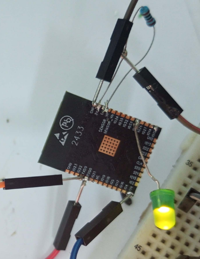

# ESP32-WROOM-32 | First UART Flash & OTA Programming

This repository shows how to program a **standalone Espressif ESP32-WROOM-32 module** for the first time with a USB-to-UART adapter, then enable **Over-the-Air (OTA)** firmware updates over Wi-Fi.

The goal is to use the compact ESP32 module instead of an entire development board when building a custom embedded system. This repository focuses on **the prototype photo, wiring, initial firmware, and OTA programming**.

## 1. Why use a standalone ESP32?

Development boards such as the ESP32 DevKit and Beetle ESP32 are useful for testing, but they include additional circuitry that a final embedded system may not need. Working with the standalone module can reduce the size of a future design and let us select only the components our application requires.

Unlike a development board, the standalone ESP32-WROOM-32 does **not** include an onboard USB-to-UART programming interface or a complete power supply circuit. We therefore connect it to external components for the **first wired firmware upload**. After installing OTA-capable firmware, we can upload later versions over Wi-Fi.

## 2. ESP32 prototype photo



*Figure 1 — Experimental ESP32 wiring with an LED and jumper connections.*

The photo documents the prototype, not a verified pin-by-pin wiring diagram. Always check the pinout of your **exact ESP32 module** before applying power.

## 3. Components and UART connections

**Components:**

- ESP32-WROOM-32 module (or a compatible ESP32 prototype with the correct connections)
- USB-to-UART adapter with **3.3 V logic levels**
- Reliable **3.3 V power supply** suitable for the ESP32's current peaks
- Wires, common ground, and appropriate pull-up resistors
- BOOT and RESET buttons or equivalent switches
- Breadboard and LED (optional)

| ESP32 signal | Connect to | Purpose |
| --- | --- | --- |
| 3V3 | Regulated 3.3 V | Module power |
| GND | Power/adapter GND | Common ground |
| GPIO1 / U0TXD | USB-to-UART RX | Transmit data |
| GPIO3 / U0RXD | USB-to-UART TX | Receive data |
| EN | Pull up to 3.3 V; button to GND | Enable/reset |
| GPIO0 | Pull up to 3.3 V; BOOT button to GND | Select serial download mode |

**Important:** Never apply 5 V directly to the ESP32's 3V3 or GPIO pins. Some USB-to-UART adapters cannot supply enough 3.3 V current to power the ESP32 reliably; use a suitable regulated supply. The adapter and ESP32 must share ground. Also ensure the other ESP32 boot-strapping pins are in valid states.

## 4. First upload using USB-to-UART

We use the **Arduino IDE** and Espressif's **ESP32 Arduino core** for this example.

1. Install the ESP32 board package in Arduino IDE using **Boards Manager**.
2. Open `firmware/esp32_ota/esp32_ota.ino`.
3. Replace `YOUR_WIFI_SSID`, `YOUR_WIFI_PASSWORD`, and `CHANGE_THIS_OTA_PASSWORD` with your own values **in your local sketch only**. Do not publish real passwords.
4. Select the appropriate classic ESP32 board target (commonly **ESP32 Dev Module** for ESP32-WROOM-32) and the serial port. Match the flash size to your actual module.
5. In **Tools → Partition Scheme**, choose a layout that **supports OTA**; do not select a `No OTA` partition scheme.
6. Connect the ESP32 to your USB-to-UART adapter using the table above.
7. To enter manual download mode: hold **BOOT** (GPIO0 LOW), briefly press and release **RESET** (EN LOW then HIGH), then release **BOOT**. Upload the sketch through the serial port.
8. After a successful upload, make sure GPIO0 is released and reset the ESP32 to start it normally.
9. Open the Serial Monitor at **115200 baud**. When connected to Wi-Fi, the ESP32 displays its IP address and confirms that OTA is ready.

Some adapter circuits automatically control BOOT and RESET, so the manual button sequence is not always necessary.

## 5. First OTA firmware (Arduino)

The following program is the **first firmware**. It connects the ESP32 to Wi-Fi and starts the ArduinoOTA service, allowing future updates over the local network.

The same code is provided as an editable Arduino sketch at [`firmware/esp32_ota/esp32_ota.ino`](firmware/esp32_ota/esp32_ota.ino).

```cpp
#include <WiFi.h>
#include <ArduinoOTA.h>

// Replace these placeholders locally before uploading.
// Do not commit your real Wi-Fi credentials or OTA password to GitHub.
const char* WIFI_SSID = "YOUR_WIFI_SSID";
const char* WIFI_PASSWORD = "YOUR_WIFI_PASSWORD";
const char* OTA_PASSWORD = "CHANGE_THIS_OTA_PASSWORD";

void setup() {
  Serial.begin(115200);
  delay(500);

  WiFi.mode(WIFI_STA);
  WiFi.begin(WIFI_SSID, WIFI_PASSWORD);

  Serial.print("Connecting to Wi-Fi");
  while (WiFi.status() != WL_CONNECTED) {
    delay(500);
    Serial.print(".");
  }
  Serial.println();
  Serial.print("Connected! IP address: ");
  Serial.println(WiFi.localIP());

  ArduinoOTA.setHostname("esp32-wroom32-ota");
  ArduinoOTA.setPassword(OTA_PASSWORD);

  ArduinoOTA.onStart([]() {
    Serial.println("OTA update started");
  });

  ArduinoOTA.onEnd([]() {
    Serial.println("\nOTA update finished");
  });

  ArduinoOTA.onProgress([](unsigned int progress, unsigned int total) {
    if (total > 0) {
      Serial.printf("OTA progress: %u%%\r", (unsigned int)(100ULL * progress / total));
    }
  });

  ArduinoOTA.onError([](ota_error_t error) {
    Serial.printf("\nOTA error: %u\n", (unsigned int)error);
  });

  ArduinoOTA.begin();
  Serial.println("OTA is ready for updates over the local Wi-Fi network.");
}

void loop() {
  // Keep OTA handling in the application, including after future updates.
  ArduinoOTA.handle();
}
```

### What the code does

- Connects the ESP32 to your Wi-Fi network.
- Prints the device's local IP address to the Serial Monitor.
- Starts OTA under the hostname `esp32-wroom32-ota`.
- Requires an OTA password when a client sends an update.
- Prints firmware-upload progress and errors.
- Runs `ArduinoOTA.handle()` repeatedly to process incoming OTA requests.

## 6. Upload future firmware over Wi-Fi

After the **first wired upload** is working:

1. Keep the ESP32 powered on and connected to the same local network as your computer.
2. Open Arduino IDE and check **Tools → Port** for a network port named like `esp32-wroom32-ota`.
3. Select the ESP32's network port, then upload the updated sketch.
4. Enter the OTA password when asked.
5. The ESP32 receives the update and normally restarts into the new firmware.

Network-port discovery depends on your system and local network (including mDNS/firewall settings). If it does not appear, verify the IP address and connectivity first.

**Important:** Every subsequent firmware version must still initialize OTA and call `ArduinoOTA.handle()` if you want to continue updating wirelessly. If firmware loses OTA support or Wi-Fi connectivity, the UART connection may be needed for recovery.

**Security:** Use a strong, unique OTA password on a trusted local network; do not expose the OTA service to the public internet. The simple ArduinoOTA example is for local prototyping, not a complete secure remote-update system.

## 7. Repository files

```text
esp32-wroom32-ota/
├── README.md
├── images/
│   └── esp32.png
└── firmware/
    └── esp32_ota/
        └── esp32_ota.ino
```

## 8. References

- [ESP32-WROOM-32 datasheet](https://documentation.espressif.com/esp32-wroom-32_datasheet_en.html)
- [Espressif Arduino-ESP32 documentation](https://docs.espressif.com/projects/arduino-esp32/en/latest/)
- [Official BasicOTA example](https://github.com/espressif/arduino-esp32/blob/master/libraries/ArduinoOTA/examples/BasicOTA/BasicOTA.ino)
- [Arduino-ESP32 partition table documentation](https://docs.espressif.com/projects/arduino-esp32/en/latest/tutorials/partition_table.html)

---

**Project scope:** Prototype photo, initial serial flashing, and Wi-Fi OTA firmware for the ESP32.
